# Lec2: 模型评估与选择
## 经验误差与过拟合
泛化能力强，就能很好的适用于unseen instance
经验误差：在训练集上的误差，亦称“训练误差”
测试误差：在测试集上的误差
泛化误差：在训练集外的所有“未来”样本上的误差
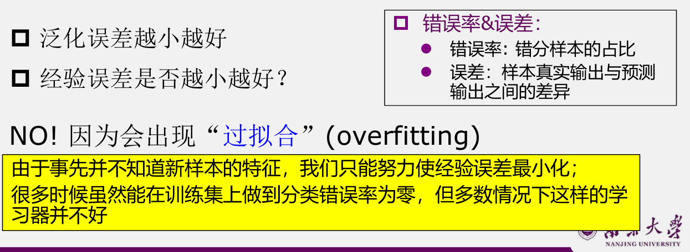
过拟合:
学习器把训练样本学习的“太好”，将训练样本本身的特点当做所有样本的一般性质，导致泛化性能下降
- 优化目标加正则项
- early stop
欠拟合：
对训练样本的一般性质尚未学好
- 决策树:拓展分支
- 神经网络:增加训练轮数

## 评估方法
测试集如何来？测试集应该和训练集互斥
- 留出法：直接把数据集分成两个互斥的集合
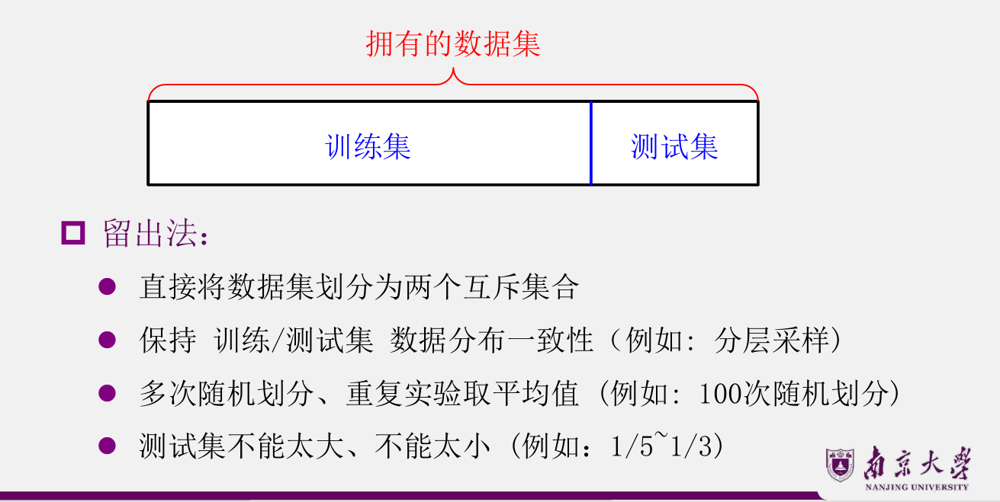
- 交叉验证法：把数据集分层采样成k个大小相似的互斥子集，每次用k-1个子集做训练，剩下一个做测试，最后返回k次结果的均值（k-fold）
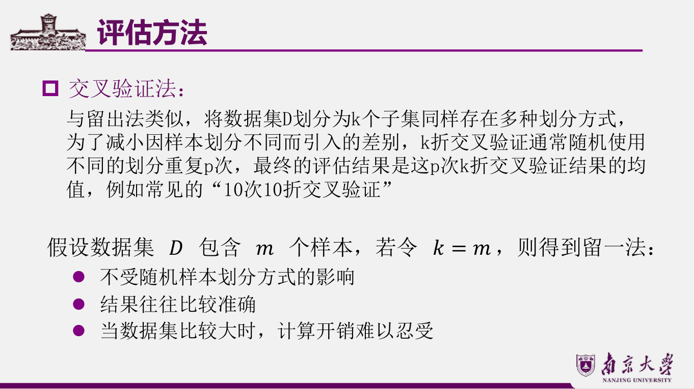
- 自助法
以自助采样法为基础，对数据集 D 有放回采样 𝑚 次得到训练集D', D\D′ 用做测试集
其中m就是数据集D的大小
所以D'和D的规模其实一样大，只是D'有重复
所以这些不在D'里面的叫做包外样本，可以用概率来算出这个比例大概是36.8%
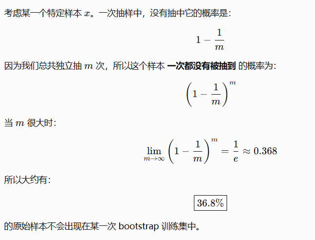

算法的参数：一般由人工设定，亦称“超参数”
模型的参数：一般由学习确定
调参的过程很重要，超参确定之后要用训练集和验证集来训练最终模型

## 性能度量
性能度量(performance measure)是衡量模型泛化能力的评价标准，反映了任务需求
使用不同的性能度量往往会导致不同的评判结果
什么样的模型是“好”的，不仅取决于算法和数据，还取决于任务需求
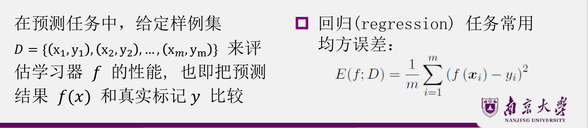
也就是在一定的测试集上跑然后比较差异
对于分类任务，错误率和精度是最常用的两种性能度量：
- 错误率：分错样本占样本总数的比例
- 精度：分对样本占样本总数的比例
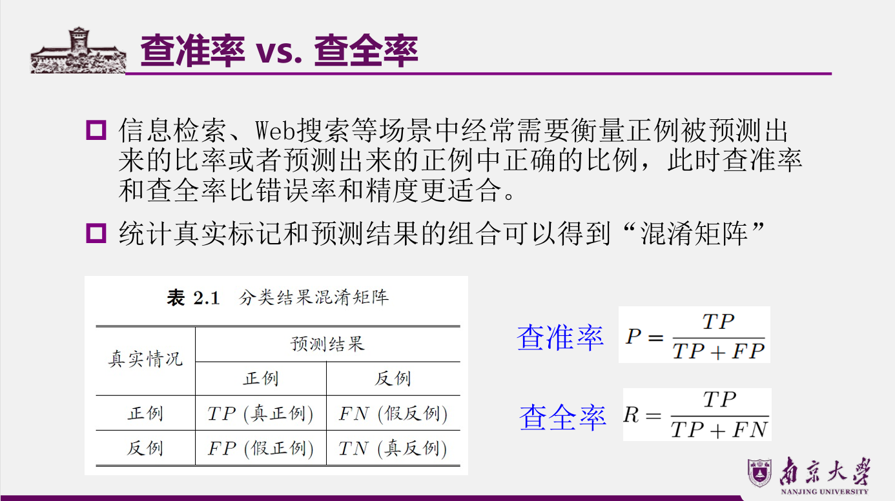

### PR曲线
在检索和搜索场景里面，我们会用到查准率和查全率
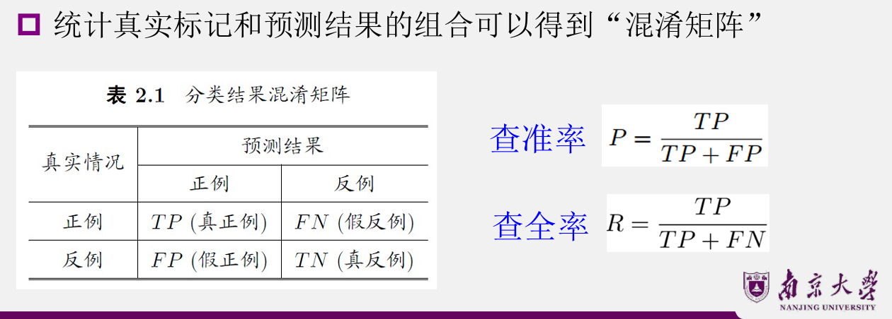
这个就是混淆矩阵，用来统计分类模型“哪些预测对了、哪些预测错了”
根据我们训练的模型的预测结果，我们可以画出一个曲线
查准率-查全率曲线，简称“P-R曲线”
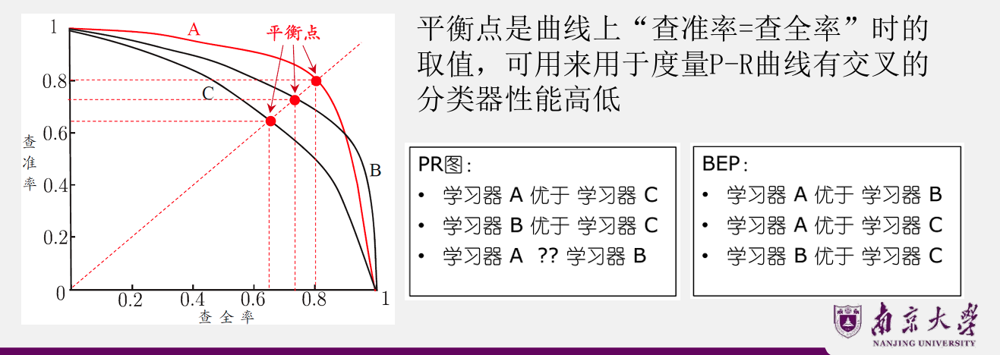
BEP指的是break event point，也就是查准率=查全率的点
因为这个模型输出的不是正/反，而是输入为正例的概率，我们可以通过改变不同的阈值（逐步降低阈值），比如概率超过阈值的为正例，这样就得到不同的P和R，从而能够绘出一条连续的曲线
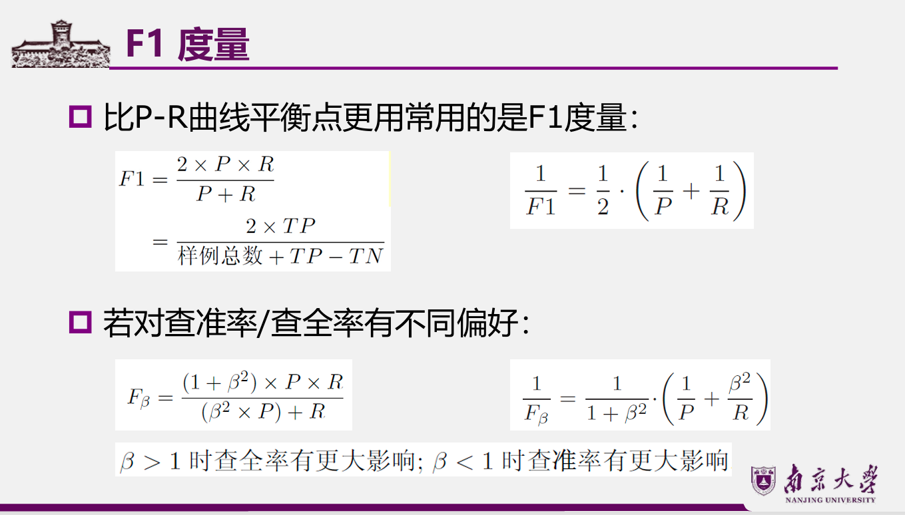
如果我们能够有多个混淆矩阵，比如多次训练、多次测试的结果或者多分类的两两混淆矩阵
我们如何把这些指标混合成一个最终指标？
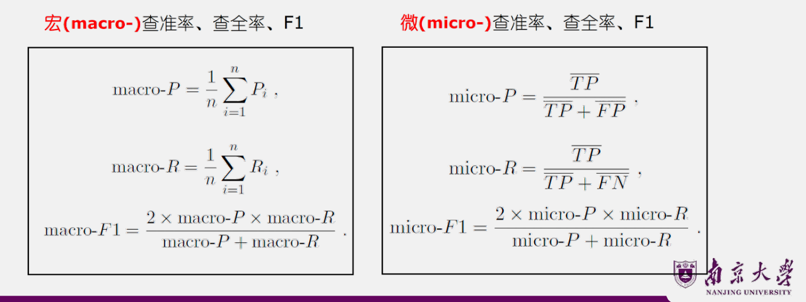
Macro：先分别计算，再平均。
Micro：先把统计量平均，再计算

### ROC和AUC
和PR曲线同样的，我们逐步降低阈值的时候，可以以假正例率为x轴，真正例率为y轴，得到ROC曲线，受试者工作特征Receiver Operating Characteristic
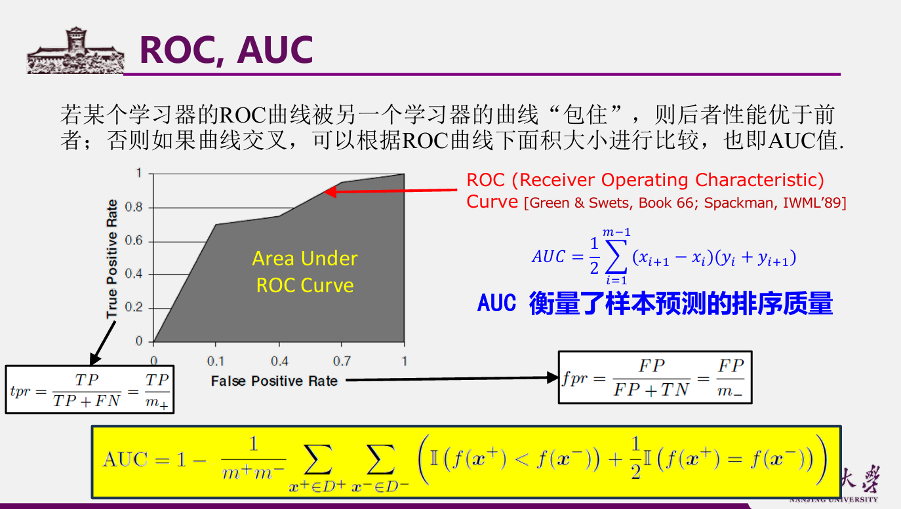
tpr也就是真正例率，也就是实际上是正例的里面我预测出来了多少。fpr是假正例率，是实际上是反例我有多少预测成了正例。
这两个的分子就是我全部预测为正例的。
绘制ROC图实际上就是我们把横纵轴分成了m和n等份，m是正例数量，n是负例数量，是真实情况的。我们按照模型预测的概率从大到小排序，每次吸取一个例子进来，也就是说我们把他认为是正例了。那么如果这个新进来的例子实际上是正例，我们就像y轴上方走一份；如果是负例，就像x轴方向走一份。比如从(0,0)出发，假如3个正3个反，先吸进来一个正，那么就到(0, 1/3)这个点，再进来一个负例，就变成(1/3, 1/3)

AUC 衡量了样本预测的排序质量，1-AUC是错误排序比例，也就是负样本排到了正样本之前
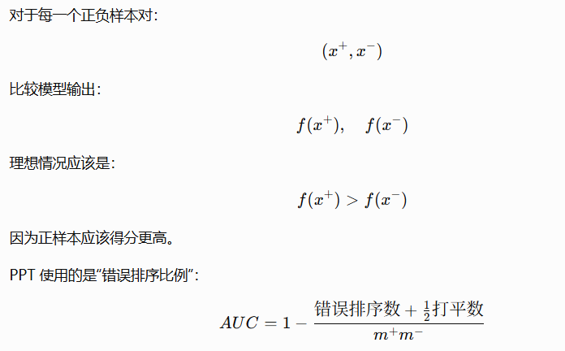
分母是两个数量的乘积，因此是总共的正负样本对的数量

### 非均等代价
现实任务中不同类型的错误所造成的后果很可能不同，为了权衡不同类型错误所造成的不同损失，可为错误赋予“非均等代价”
在非均等代价下，不再最小化错误次数，而是最小化“总体代价”
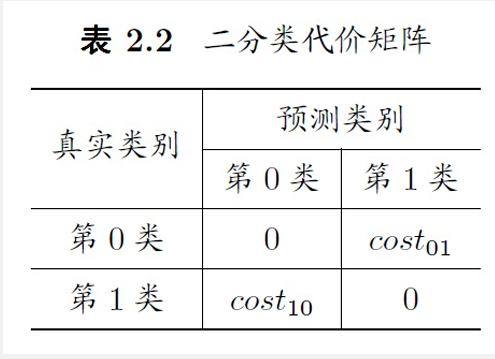
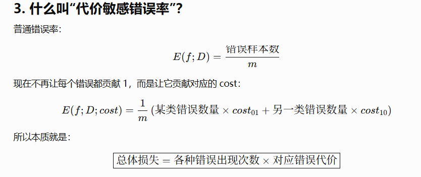
ROC可以告诉你漏掉多少正类、误报多少负类。
但是 ROC 不知道两种错误哪个更贵，所以需要代价曲线
我们先定义一个$p$，是先验概率，代表现实环境中，一个随机样本是正类的概率。
比如一个疾病的患病率是0.1，这个是先验的
然后$p/times FNR$是这个样本是正类并且我把他判成了负类的概率，因为FNR就是1-TPR，然后乘上这个代价
再加上把负类样本错判成正类的概率乘以代价，就得到$E_{cost}$，期望总代价

代价曲线的横轴是正例概率代价，取值是[0,1]
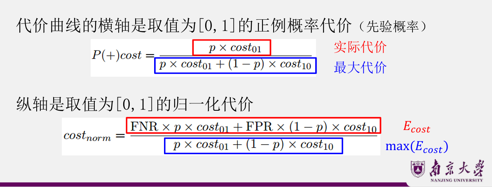
在正负例的场景里面$cost_{01}$也就是FN的cost，也就是你把正例错判成负例的cost
如果这个分子越大，那么x趋于1，那么costFN也就越重
横纵轴的分母是一样的，是最大代价，理论上来说如果FNR和FPR都取1，就得到这个最大代价

我们这样定义了xy之后，很容易可以得到
$$
y=(1-x)FPR+xFNR
$$
这是一个一次函数的形式，因此他过两个定点，(0,FPR)和(1,FNR)
所以只要把这两个定点连起来，就能得到这个阈值下的代价曲线（因为不同阈值会改变FPR和FNR）
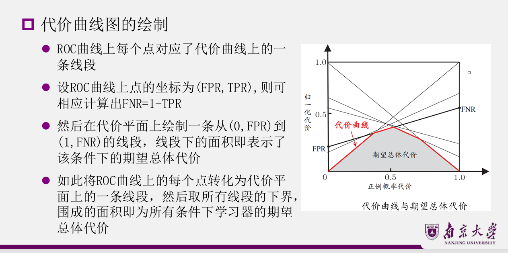

## 比较检验
根据某种评估方法，我们得到了评估结果，那么我们可以直接比较两个学习器的优劣吗？
不可以，因为测试性能不等于泛化性能，性能会随着测试集的变化而变化

假设检验可以让我们判断A的泛化性能是否在统计意义上优于B，并且有多大把握

### 交叉验证t检验（两学习器比较）
假设我们做 k 折交叉验证。对学习器 A，得到 k 个测试误差：
$\hat{\epsilon}_1^A, \hat{\epsilon}_2^A, \ldots, \hat{\epsilon}_k^A$
对B也有 $\hat{\epsilon}_1^B, \hat{\epsilon}_2^B, \ldots, \hat{\epsilon}_k^B$
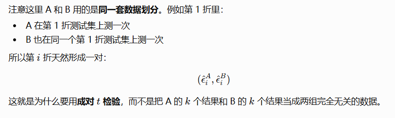
然后我们对每一对结果求差，$\Delta_i=\epsilon_i^A-\epsilon_i^B$
我们用这些差来对“学习器A和B性能相同”这个假设做t检验

什么是t检验？
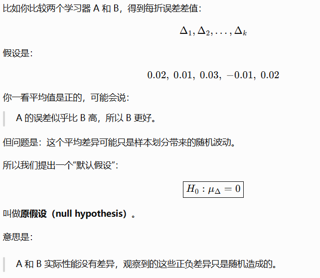
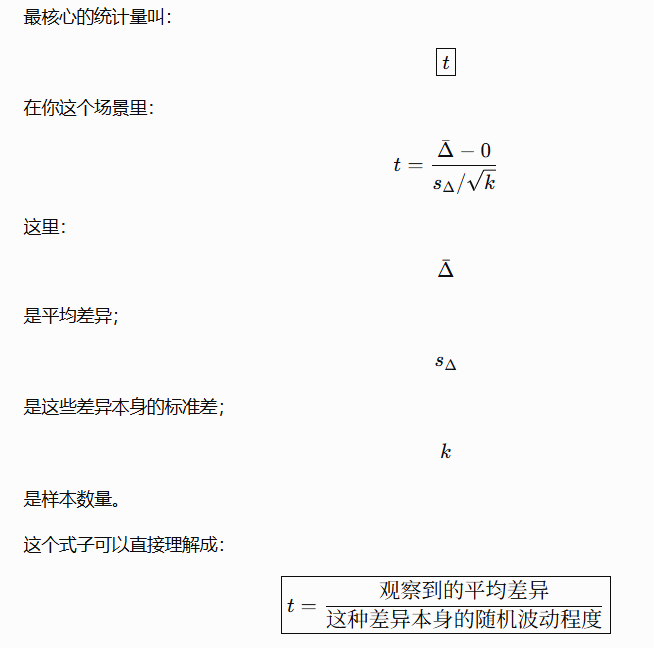
这样得到一个t之后，我们可以根据t的分布，算出一个概率p
这个p表示如果假设是对的，得到这样一个t值的概率是多少
t分布是一族分布，我们确定一个自由度之后，就可以确定这个自由度下的t分布，根据这个分布算出概率p
算出来之后我们就可以得到原假设成立的概率

但是假设检验希望测试得到的错误率是相互独立的采样，由于样本有限，交叉验证会导致训练集重叠，从而导致并不独立
我们可以用5*2交叉验证来缓解这一问题

5*2指的是做5次二折交叉验证，每次验证之前把数据打乱，让每次数据划分不重复
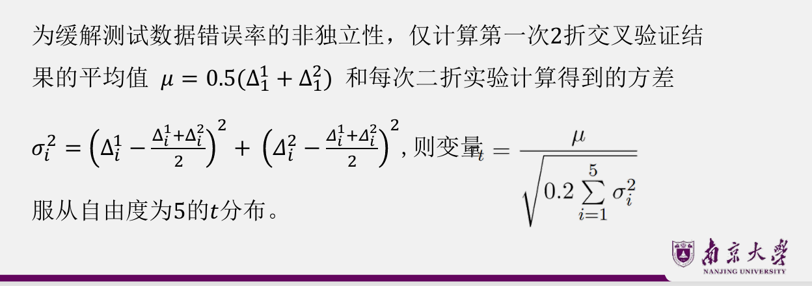

### McNemar检验（两学习器比较）
用留出法，也就是把数据集分成训练集和测试集两部分，适合用这种方法来做检验
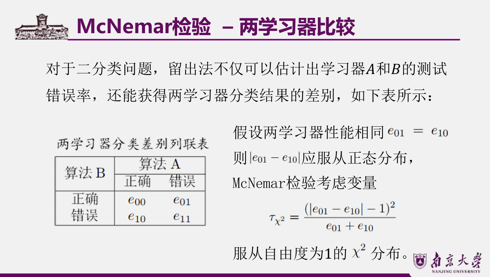
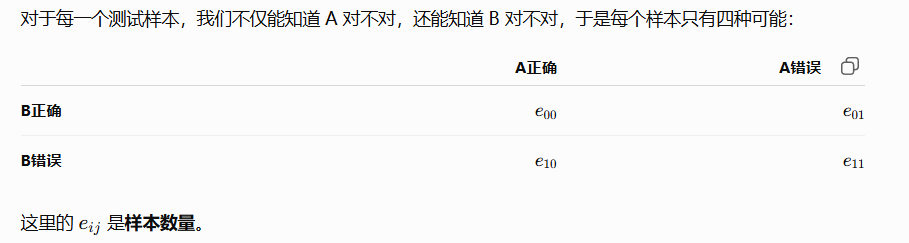
同样的我们提出A和B性能相同的原假设，那么如果e01=e10，我们认为这俩性能相同
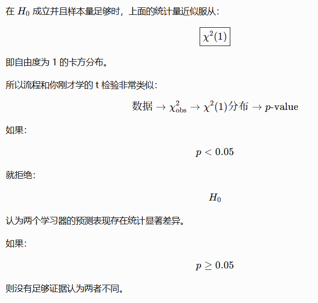

### Friedman检验（多学习器比较）
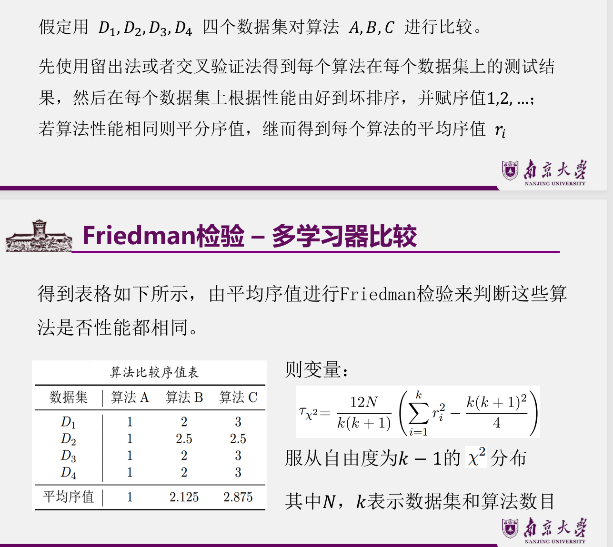
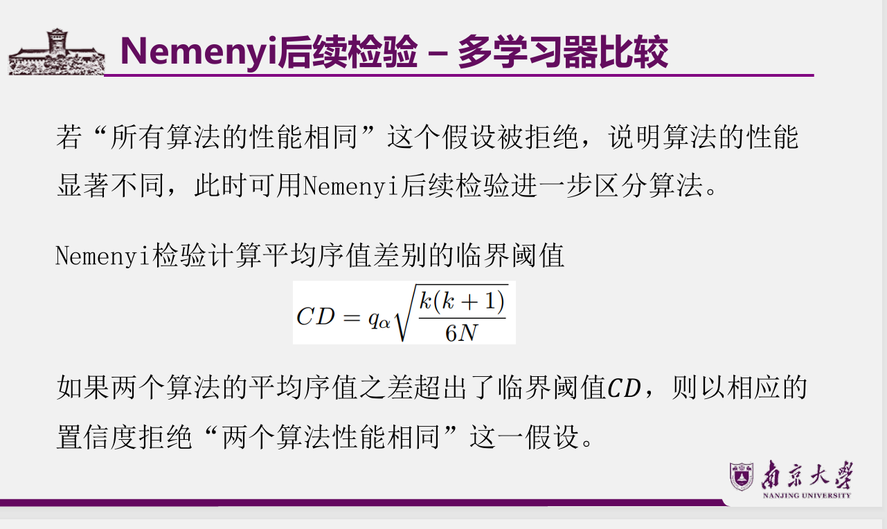
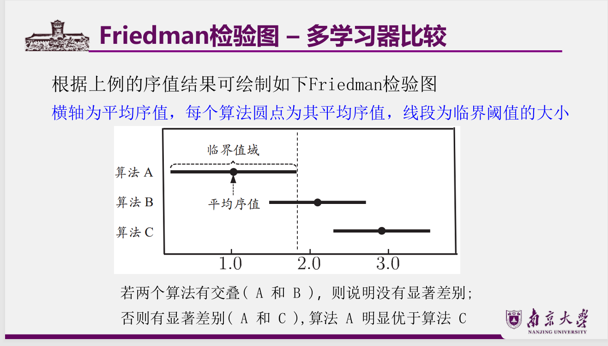

## 偏差与方差
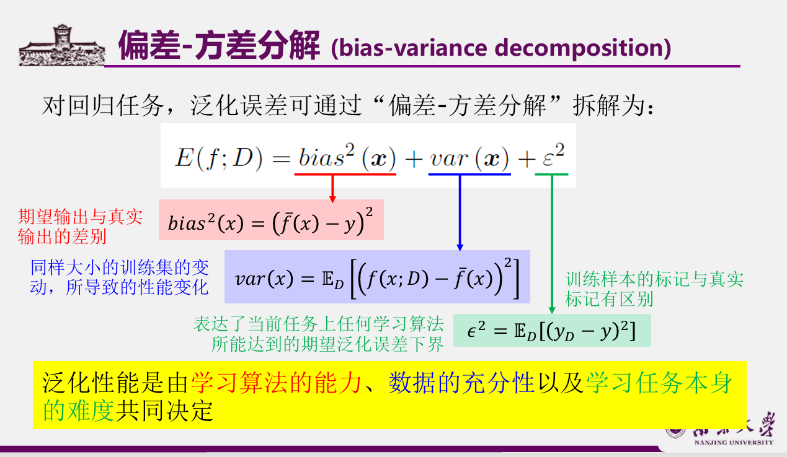
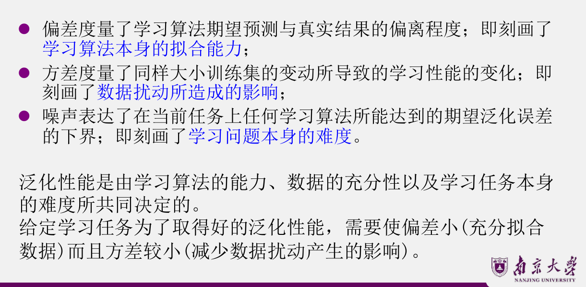
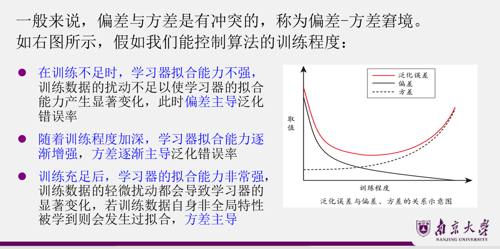